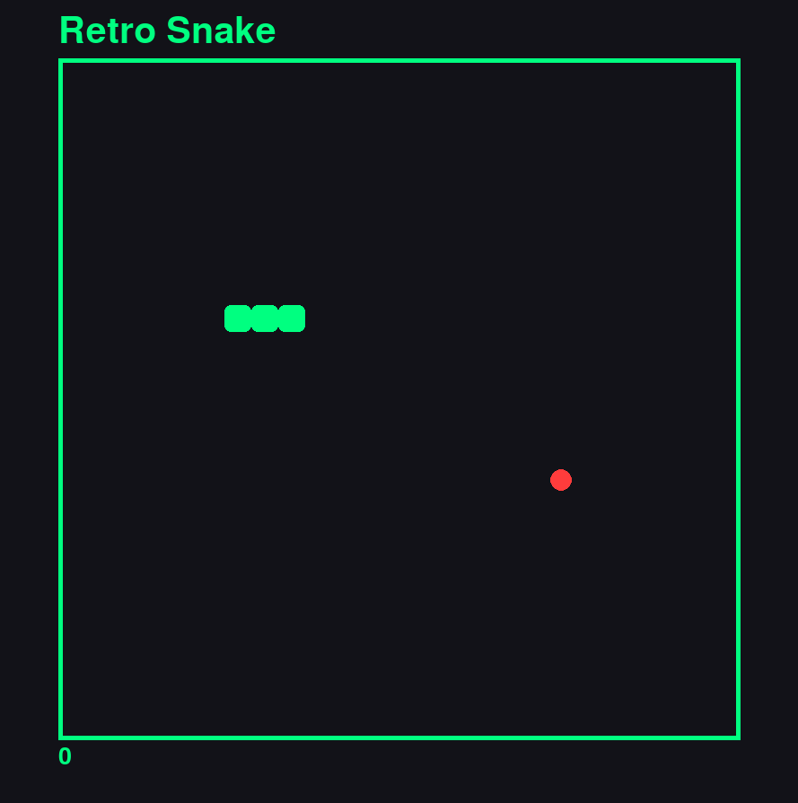

# 🐍 Retro Snake

A classic Snake game built with **Python** and **Pygame** featuring a neon dark theme. Eat food, grow longer, and don't hit the walls or yourself.

## 📸 Preview



## ✨ Features

- Random food spawning
- Live score tracking
- Game over on wall or self-collision

## 🛠️ Requirements

- Python 3.8+
- Pygame 2.x

## 📦 Installation

```bash
git clone https://github.com/mobx-100/snake-game-python.git
cd snake-game-python
pip install pygame
python main.py